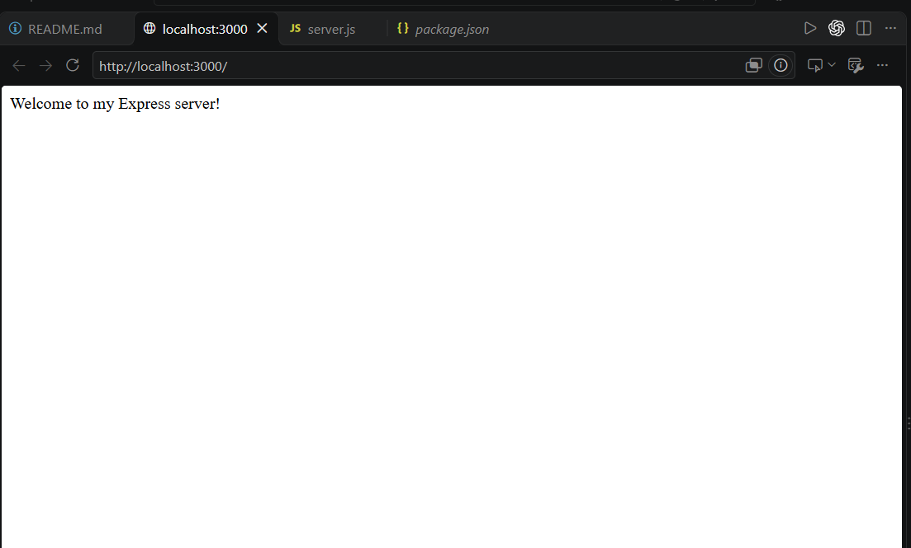
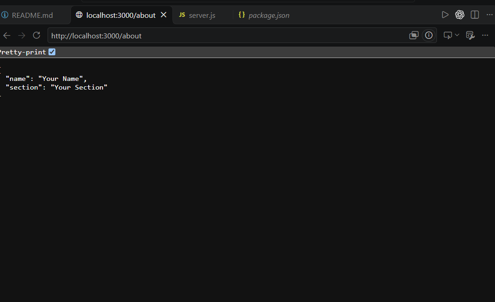
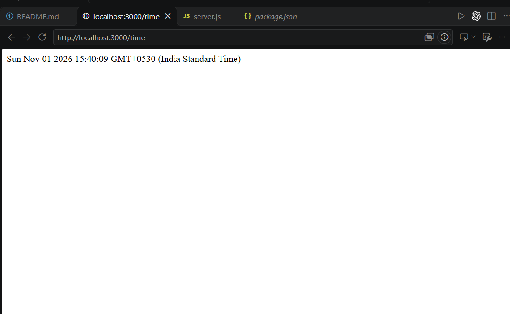
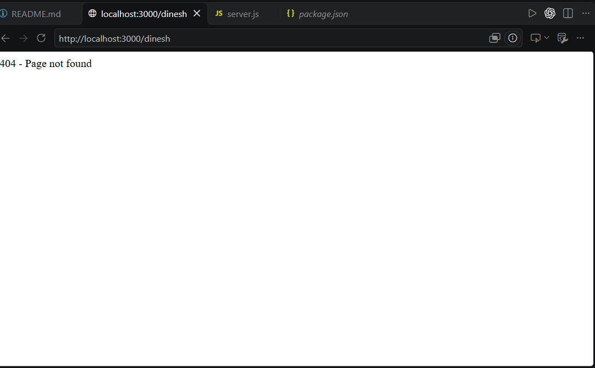

# Lab 1: Node.js and Express server

Name: Chenchu Dinesh
Registration number: 252U1R9002
Section: Gen-Ai(2A)

Live link: PASTE PUBLIC URL HERE (or explain why it could not be deployed and add Postman screenshots)

## How to run

```bash
npm install
npm start            # Express server (server.js) on port 3000
npm run start:http   # plain http module version (http-server.js)
```

No environment variables are required (optional: `PORT`, default 3000).

## Endpoints

| Method | Path     | Description                          | Status |
| ------ | -------- | ------------------------------------ | ------ |
| GET    | `/`      | Welcome text                         | 200    |
| GET    | `/about` | JSON with name and section           | 200    |
| GET    | `/time`  | Current date and time                | 200    |
| GET    | any other | "404 - Page not found" message      | 404    |

## Screenshots






## Notes

Problems faced and how I solved them: WRITE HERE.
