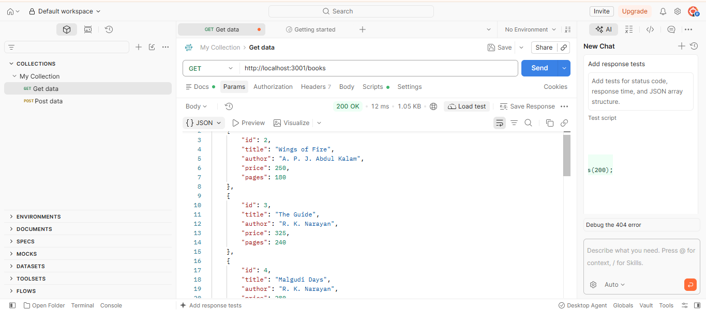
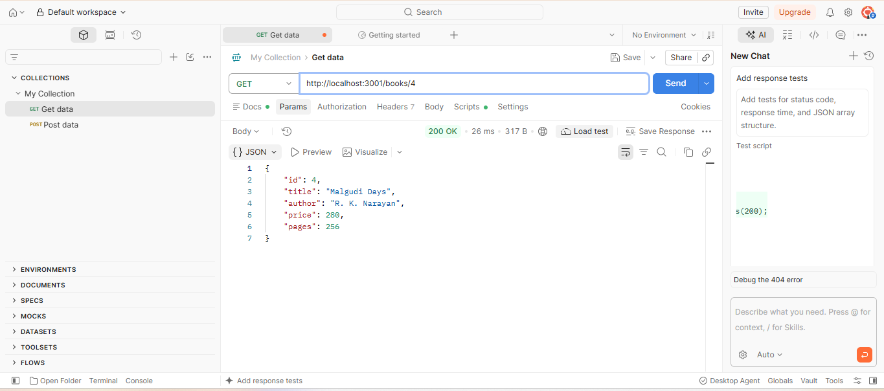
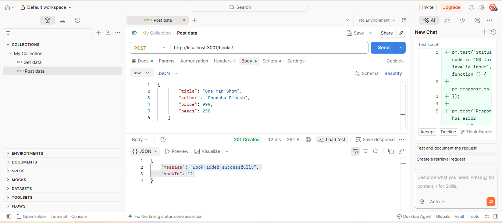
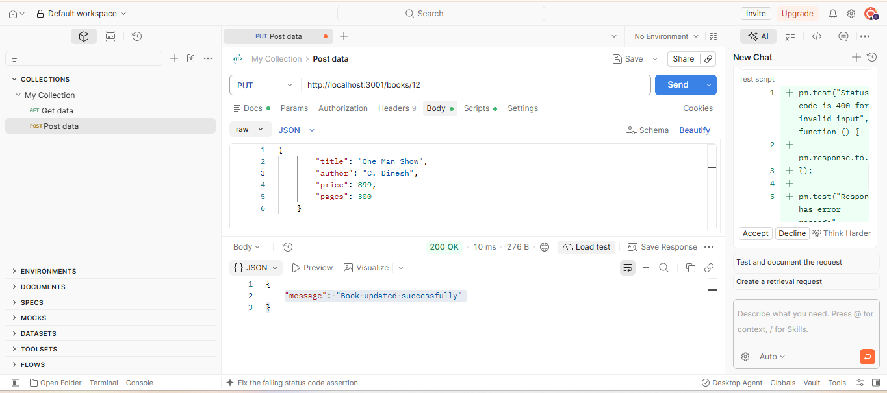
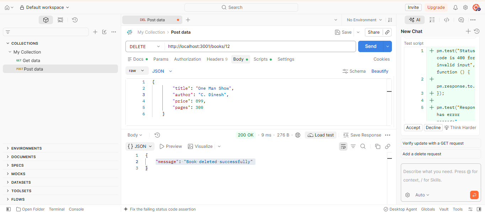
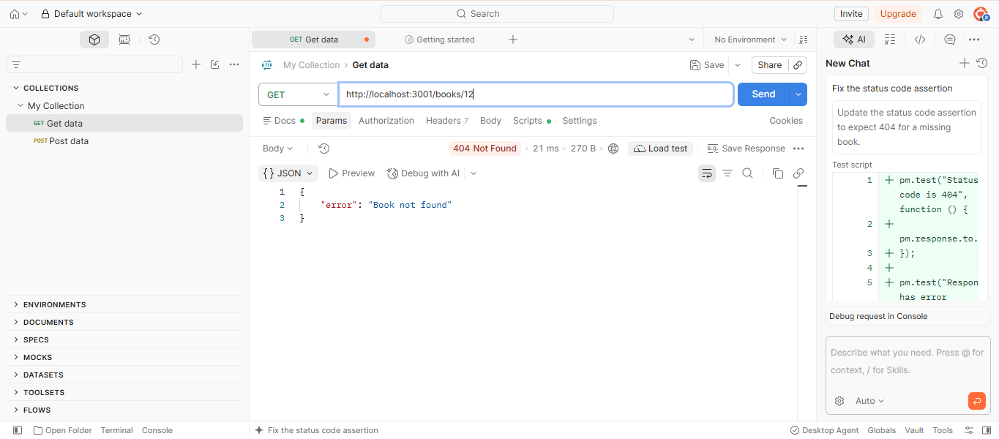

# Lab 2: SQLite database and CRUD routes

**Name:** Chenchu Dinesh · **Registration number:** 252U1R9024 · **Section:** CSE-GenAI-2A

**Live link:** 
https://backend-lab-reports-fcid.onrender.com

Backend Development Fundamentals · Year II Term II · Faculty: Joel Prashanth D

An Express server connected to a SQLite database (`book.db`) that exposes CRUD operations for a `book` table.

## How to run

```bash
cd lab-02
npm install
npm run dev      # nodemon: restarts on every change
# or
npm start        # plain node
```

Environment variables (optional, see `.env.example`):

| Variable | Description | Default |
| --- | --- | --- |
| `PORT` | Port the server listens on | `3000` |

The database file `book.db` is included. To rebuild it from scratch:

```bash
rm book.db
sqlite3 book.db < schema.sql
```

### Table

```sql
book(id INTEGER PRIMARY KEY, title TEXT, author TEXT, price INTEGER, pages INTEGER)
```

## Endpoints

| Method | Path | Description | Success | Errors |
| --- | --- | --- | --- | --- |
| GET | `/books/` | Return all books | 200 | 500 |
| GET | `/books/:bookId/` | Return one book by id | 200 | 404, 500 |
| POST | `/books/` | Add a new book | 201 `{ "bookId": n }` | 400, 500 |
| PUT | `/books/:bookId/` | Replace the details of an existing book | 200 | 400, 404, 500 |
| DELETE | `/books/:bookId/` | Delete a book | 200 | 404, 500 |

Request body for POST and PUT:

```json
{ "title": "Python Crash Course", "author": "Eric Matthes", "price": 599, "pages": 544 }
```

All queries that take user input use `?` placeholders (parameterised queries).

## Screenshots

The following screenshots demonstrate the successful execution of all CRUD routes and error handling.

### 1. GET – All Books


### 2. GET – Book by ID


### 3. POST – Add New Book


### 4. PUT – Update Book


### 5. DELETE – Delete Book


### 6. Error Handling


### 7. SQLite CLI
[Database in SQLite CLI after changes](screenshots/Sql-cli.png)
-->

## Notes: problems faced and how I solved them

- WRITE YOUR OWN NOTES HERE (for example: forgetting `await` on `db.all`, the server starting before the DB connection, or placeholder syntax).
